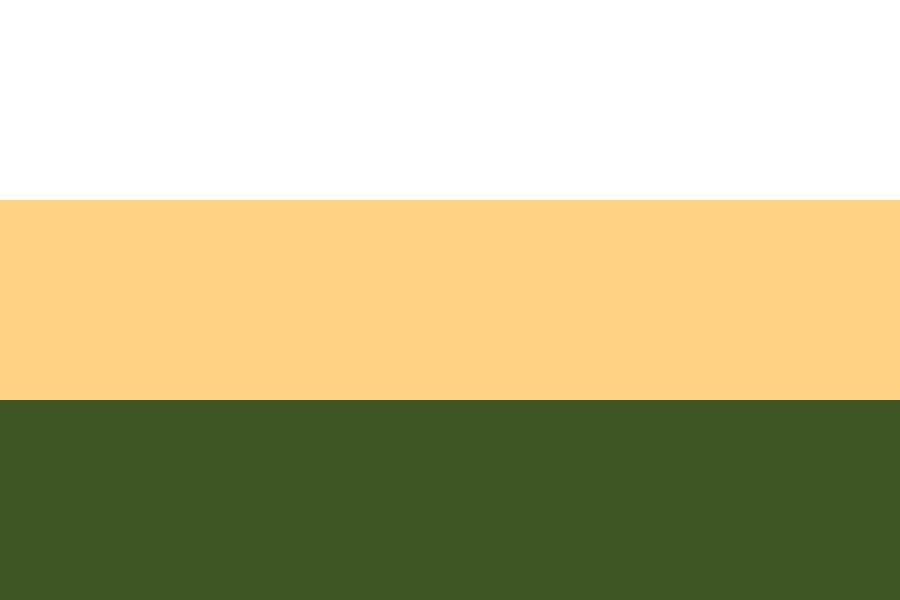

# About the Republic

Goodfellows Republic is a country brought together by a shared identity and a spirit of fellowship. This website introduces the Republic and provides a place to learn about its values and community.

## Our national colors

Our flag has three horizontal stripes of equal height: **white** (`#FFFFFF`), **golden sand** (`#FFD284`), and **forest green** (`#3E5524`), from top to bottom.

The flag preserves our national colors. The website draws on these colors with shaded olive and moss backgrounds, warm sand accents, and soft ivory text.

## Our Constitution

The [Constitution of the Goodfellows Republic](/constitution) sets out the Republic's institutions, citizenship, rights, and government procedures. It describes the Republic as a constitutional republic administered primarily through its recognized Discord community. Read the full text online or open the original PDF.

## Explore the Republic

- [Our values](/values) — the ideas that guide our community.
- [Civic life](/community) — participation and dialogue.
- [Contact](/contact) — connect with the Republic.
